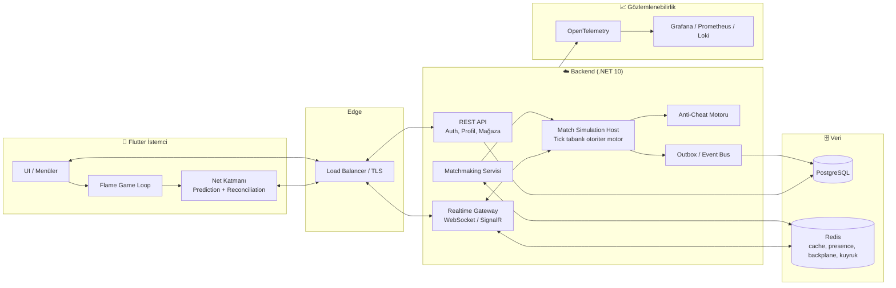

# 🚒 FIREMAN • Faz 2: Teknik Yol Haritası ve Yapılacaklar

> **Kapsam:** Mevcut "Proje Geliştirme ve Mimari Raporu"nun devamıdır. Faz 1'de iskelet, domain, API ve offline oyun prototipi tamamlandı. Faz 2'nin hedefi, projeyi **üretim kalitesinde, ölçeklenebilir, hileye dayanıklı bir mobil online "Playing with Fire" oyununa** dönüştürmektir.
>
> **Doküman durumu:** Taslak v1.0 • **Sahip:** Proje ekibi • **Hedef:** Public Beta

---

## 0. Mevcut Durum Teşhisi (Gap Analizi)

Faz 1 raporunun dürüst bir okuması, aşağıdaki kritik boşlukları ortaya koyuyor. Faz 2 bu boşlukları kapatmaya odaklanır.

| # | Tespit | Risk | Öncelik |
|---|--------|------|---------|
| G1 | Oyun motoru (`BombermanPainter`, botlar, bomba/patlama mantığı) **istemcide** çalışıyor. Online modda herkes kendi simülasyonunu çalıştırırsa durum senkronsuz ve hileye açık olur. | 🔴 Kritik | P0 |
| G2 | `MatchRealtimeContracts` **3D pozisyon/rotasyon** içeriyor; oyun ise **11×9 2D grid**. Anti-cheat'teki `16 m/s` / `40 m/s` eşikleri grid tabanlı oyunla uyumsuz. | 🔴 Kritik | P0 |
| G3 | Veri katmanı "In-Memory DB & Cache" ile çalışıyor. PostgreSQL provider eklenmiş ama **migration, gerçek ortam ve kalıcılık doğrulanmamış**. | 🟠 Yüksek | P0 |
| G4 | SignalR tek sunucu varsayımıyla çalışıyor; **yatay ölçekleme (backplane), reconnect ve oturum geri kazanımı** tanımlı değil. | 🟠 Yüksek | P1 |
| G5 | Test durumu yalnızca "derleniyor / analyze temiz" düzeyinde. **Birim, entegrasyon, simülasyon ve yük testi yok.** | 🟠 Yüksek | P0 |
| G6 | CI/CD, container, ortam yönetimi (dev/stage/prod), gözlemlenebilirlik (log/metric/trace) tanımlı değil. | 🟠 Yüksek | P1 |
| G7 | "Modüler Monolit" iddiası var ama **modül sınırları kodla zorlanmıyor** (tek solution, 10 proje). | 🟡 Orta | P2 |
| G8 | Mobil istemci: `CustomPaint` ile 2D çizim, sprite atlas / ses motoru / efekt sistemi / oyun döngüsü soyutlaması yok. | 🟡 Orta | P1 |
| G9 | Ürün katmanı eksik: push bildirim, yerelleştirme, analytics, crash reporting, mağaza hazırlığı. | 🟡 Orta | P2 |

---

## 1. Hedef Mimari



**Temel ilkeler**

1. **Sunucu gerçeğin tek kaynağıdır.** İstemci niyet (input) gönderir; sunucu simüle eder ve durumu yayınlar.
2. **Deterministik, tick tabanlı simülasyon.** Aynı girdi dizisi aynı sonucu üretmelidir (replay, test ve hata ayıklama için).
3. **Domain saf kalır.** Simülasyon çekirdeği (`Fireman.GameCore`) hiçbir altyapıya (DB, SignalR, zaman, rastgelelik) doğrudan bağımlı olmaz.
4. **İstemci ince ve hızlı hissettirir.** Tahmin (prediction) ile gecikme gizlenir, sunucu kararı esas alınır.

---

## 2. İş Paketleri (Work Packages)

### WP1 — Otoriter Oyun Simülasyonu: `Fireman.GameCore` 🔴 P0

**Amaç:** Bomba, patlama, zincirleme reaksiyon, varil, güçlendirici ve hasar mantığını sunucuya taşımak.

**Yapılacaklar**

- [ ] Yeni proje: `Fireman.GameCore` (saf C#, sıfır dış bağımlılık, `net10.0` class library).
- [ ] **Sabit zaman adımlı döngü:** 30 Hz simülasyon tick'i (`dt = 33.33 ms`), render'dan bağımsız.
- [ ] Grid durum modeli: `Tile[]` (Empty, Wall, Barrel), `Bomb`, `Flame`, `PowerUp`, `Player` varlıkları.
- [ ] Hareket modeli: grid üzerinde **hücre-arası akıcı hareket** (sub-tile pozisyon, tamsayı fixed-point, örn. 1/256 hücre) — float kaynaklı senkron kaymasını önlemek için.
- [ ] Çarpışma: duvar, varil, bomba (bırakan oyuncu bombadan çıkana kadar geçebilir kuralı).
- [ ] Bomba sistemi: fitil sayacı tick bazlı (~2.2 sn ≈ 66 tick), menzil, aynı anda bomba limiti.
- [ ] Patlama: 4 yönlü yayılım, duvarda durma, varilde durma + yok etme, **zincirleme patlama kuyruğu** (BFS, aynı tick içinde çözülür).
- [ ] Güçlendirici düşürme: `IRandom` soyutlaması + **seed'li RNG** (deterministik drop).
- [ ] Hasar / can / ölüm / yeniden doğma (veya tur sonu) kuralları.
- [ ] Maç kural motoru: tur süresi, sudden death (daralan arena), kazanan belirleme, beraberlik.
- [ ] `IClock`, `IRandom`, `ITickSource` arayüzleri ile tam test edilebilirlik.
- [ ] **Girdi modeli:** `PlayerInput { tick, moveDir, placeBomb, seq }`.
- [ ] **Durum anlık görüntüsü:** `WorldSnapshot { tick, hash, entities[] }` + delta çıkarma.

**Kabul kriterleri**

- Aynı seed + aynı girdi akışı → bit-bit aynı `WorldSnapshot.hash` (golden test).
- 4 oyunculu maç simülasyonu tek çekirdekte **< 1 ms/tick**.
- Zincirleme patlama senaryoları (haç, L, uzun zincir, varil + bomba karışık) için ≥ 40 birim testi.

**İskelet örneği**

```csharp
public sealed class MatchSimulation
{
    private readonly IRandom _rng;
    private WorldState _state;

    public MatchSimulation(MatchConfig config, IRandom rng) { /* ... */ }

    public TickResult Step(ReadOnlySpan<PlayerInput> inputs)
    {
        _state.Tick++;
        ApplyInputs(inputs);      // hareket + bomba bırakma
        TickBombs();              // fitil sayaçları
        ResolveExplosions();      // zincirleme patlama (BFS)
        TickFlames();             // alev ömrü, hasar
        CollectPowerUps();
        EvaluateRules();          // ölüm, tur sonu, sudden death
        return new TickResult(_state.Tick, _state.ComputeHash(), _events.Drain());
    }
}
```

---

### WP2 — Netcode (Gerçek Zamanlı İletişim) 🔴 P0

**Amaç:** Düşük gecikmeli, kayba dayanıklı, hile yapılamayan istemci-sunucu senkronu.

**Yapılacaklar**

- [ ] **Protokol revizyonu:** 3D pozisyon alanlarını kaldır; grid + sub-tile (fixed-point) modeline geç. `MatchRealtimeContracts` v2.
- [ ] **Binary serileştirme:** SignalR **MessagePack** protokolü (JSON'a göre ~%60–70 daha küçük payload) veya özel binary WebSocket çerçevesi.
- [ ] **Sunucu → istemci:** 15–20 Hz snapshot yayını + olay akışı (`BombPlaced`, `Exploded`, `PowerUpSpawned`, `PlayerDied`).
- [ ] **İstemci → sunucu:** her tick girdi paketi (`seq` numaralı), son N girdiyi tekrar gönder (paket kaybı toleransı).
- [ ] **Client-side prediction:** yerel oyuncu hareketini anında uygula.
- [ ] **Server reconciliation:** sunucu onaylı `lastProcessedSeq` ile uzlaştırma, uyuşmazlıkta yumuşak düzeltme.
- [ ] **Entity interpolation:** uzak oyuncuları ~100 ms geriden interpolasyonla çiz.
- [ ] **Saat senkronu:** RTT/offset ölçümü (NTP benzeri), tick numarası üzerinden ortak zaman.
- [ ] **Yeniden bağlanma:** 30 sn içinde aynı maça dönüş, tam snapshot ile durum yakalama.
- [ ] **Backpressure & rate limit:** oyuncu başına girdi paketi üst sınırı.
- [ ] **Ağ simülasyon aracı:** gecikme/jitter/kayıp enjekte eden test proxy'si (ör. 100 ms RTT, %5 kayıp).

**Kabul kriterleri**

- 100 ms RTT ve %5 paket kaybında oynanabilirlik: görünür "rubber-banding" < %2 tick.
- Oyuncu başına ortalama bant genişliği: **< 8 KB/s** (indirme), **< 2 KB/s** (yükleme).
- Bağlantı kopup 10 sn içinde dönen oyuncu maça sorunsuz devam eder.

---

### WP3 — Veri Katmanı: Gerçek PostgreSQL + Redis 🟠 P0

**Yapılacaklar**

- [ ] In-Memory sağlayıcıyı yalnızca test projelerine taşı; `Development` dahil tüm ortamlarda PostgreSQL kullan.
- [ ] EF Core **migration** setini oluştur (`InitialCreate`, versiyonlu), CI'da `migrations script --idempotent` doğrulaması.
- [ ] Docker Compose ile yerel geliştirme ortamı: `postgres:17`, `redis:7`, `api`, `pgadmin` (opsiyonel).
- [ ] İndeks stratejisi: liderlik tablosu, `UserId + Status`, `MatchId`, `CreatedAt` zaman serisi sorguları.
- [ ] Liderlik tablosu: **Redis Sorted Set** (`ZADD/ZREVRANK`) ile O(log N) sıralama, PostgreSQL'e periyodik snapshot.
- [ ] `CacheKeys` + **cache-aside** kalıbı, `CacheInvalidationHandlers` Redis tabanlı hâle getirilecek.
- [ ] **Outbox** işlemcisi: `FOR UPDATE SKIP LOCKED` ile çoklu instance güvenli tüketim, yeniden deneme + dead-letter.
- [ ] `IdempotencyService`: Redis `SET NX EX` + sonuç önbelleği; satın alma/ödül uçlarında zorunlu `Idempotency-Key`.
- [ ] Optimistic concurrency (`xmin` / `RowVersion`) cüzdan ve envanter işlemlerinde.
- [ ] Seed veri: görev tanımları, eşya kataloğu, sezon ödül kademeleri.
- [ ] Yedekleme / geri yükleme prosedürü (pg_dump + PITR notları).

**Kabul kriterleri**

- Sıfırdan `docker compose up` ile 2 dakika içinde çalışan tam ortam.
- Cüzdan çift harcama testi (paralel 100 istek) → **sıfır** tutarsızlık.

---

### WP4 — Matchmaking, Lobi ve Oyun Odası Yönetimi 🟠 P1

**Yapılacaklar**

- [ ] **Matchmaking servisi:** kuyruk (Redis), MMR/ELO tabanlı eşleştirme, bekleme süresine göre genişleyen aralık.
- [ ] Modlar: Hızlı Maç (4 kişi, free-for-all), Dereceli, Özel Oda (davet kodu), Arkadaşla Oyna.
- [ ] Lobi durum makinesi (mevcut `StateMachine<>`): `Lobby → Ready → Starting(3-2-1) → InProgress → Finished → Results`.
- [ ] **Match Host** soyutlaması: simülasyonu çalıştıran `IHostedService`/actor; bir süreç birden çok maç barındırır.
- [ ] **Oda yönlendirme (sticky routing):** aynı maçın oyuncuları aynı instance'a bağlanır (maç → instance haritası Redis'te).
- [ ] **Bot doldurma:** kuyruk X sn'yi aşarsa sunucu tarafı yapay zeka botlarla tamamla (bot mantığı `GameCore` içinde, deterministik).
- [ ] AFK / terk etme: otomatik bot devralma, terk cezası, tekrar katılım penceresi.
- [ ] Maç sonu: skor, XP, altın hesaplama → **tek transaction** + Outbox olayı.
- [ ] **ELO/MMR** güncellemesi ve sezon ilerlemesi (Battle Pass XP).

**Kabul kriterleri**

- Ortalama eşleşme süresi (yoğun saat) < 15 sn; bot doldurma devreye girme eşiği yapılandırılabilir.
- Maç sonu ödül dağıtımı **idempotent** (aynı maç iki kez ödül vermez).

---

### WP5 — Anti-Cheat v2 (Grid Uyumlu, Sunucu Otoriter) 🔴 P0

Sunucu artık simülasyonu kendisi çalıştırdığı için hile sınıfı değişir: **hile yapılamayan** şeyler (hız, ışınlanma, sonsuz bomba) mimari olarak imkânsız hâle gelir; doğrulama **davranışsal** analize kayar.

**Yapılacaklar**

- [ ] Eski `16 m/s` / `40 m/s` eşiklerini kaldır; yerine **girdi doğrulama** koy:
  - Tick başına maksimum hareket < 1 sub-tile adımı × hız çarpanı.
  - Geçersiz girdi `seq` (geri sarma, atlama, tekrar) reddi.
  - Bomba limiti ve cooldown sunucuda zorunlu.
- [ ] **Davranışsal analiz:**
  - Bot benzeri girdi kalıpları (aşırı düzgün zamanlama, insan dışı tepki süresi < 80 ms).
  - Aşırı isabetli kaçınma / "duvar görme" (fog yoksa bile istatistiksel anomali).
  - Aynı IP/cihazdan çoklu hesapla maç manipülasyonu (win-trading).
- [ ] **Risk skoru** modeli: ihlal ağırlıkları → eşik aşılırsa `Shadow flag → Review → Ban` hattı (otomatik ban yalnızca yüksek güvenli ihlallerde).
- [ ] İstemci bütünlüğü: **Play Integrity API** (Android) / **App Attest** (iOS) ile cihaz doğrulama.
- [ ] Replay kaydı: her maçın **girdi günlüğü + seed** saklanır (kompakt, ~KB'lar) → şüpheli maçlar yeniden oynatılarak doğrulanır.
- [ ] Admin paneli: ihlal listesi, replay oynatıcı, itiraz (appeal) akışı.
- [ ] Yanlış pozitif metriği: ban itiraz kabul oranı izlenir.

**Kabul kriterleri**

- Hız/ışınlanma/sonsuz-bomba hilesi simülatörde **uygulanabilir değil** (sunucu girdiyi yok sayar).
- Replay ile bir maçı bit-bit yeniden üretme başarı oranı %100.

---

### WP6 — Flutter İstemci Modernizasyonu 🟠 P1

**Yapılacaklar**

**Oyun motoru**
- [ ] `CustomPaint` yerine **Flame** (veya eşdeğer bir oyun döngüsü katmanı) ile yeniden yapılandırma: `FlameGame`, bileşen sistemi, kamera, ölçekleme.
- [ ] **Sprite atlas** + animasyon durum makinesi (yürüme 4 yön, ölüm, zafer, bomba fitil, patlama, varil kırılma).
- [ ] Parçacık efektleri (patlama kıvılcımı, duman, toz), ekran sarsıntısı, hit-stop.
- [ ] Ses motoru: SFX (bomba, patlama, toplama, ölüm) + dinamik müzik, ses kanalı yönetimi, `audioplayers`/`flame_audio`.
- [ ] Haptic geri bildirim (`HapticFeedback`, desteklenen cihazlarda ince titreşim desenleri).
- [ ] **Offline mod = aynı `GameCore`**: C# simülasyonunu Dart'a elle çevirmek yerine kural setini **sözleşme + ortak test vektörleri** ile eşitle (golden dosyalar: girdi akışı → beklenen hash). Böylece iki motor arasında sapma testle yakalanır.

**Mimari / durum yönetimi**
- [ ] Provider → **Riverpod** (veya BLoC) geçişi: test edilebilirlik, derleme zamanı güvenliği, otomatik dispose.
- [ ] Gezinme: `go_router`, tipli rotalar, derin bağlantılar (davet linki ile lobiye giriş).
- [ ] Katmanlar: `presentation / application / domain / data` (feature-first klasörleme).
- [ ] Veri modelleri: `freezed` + `json_serializable`; API istemcisi `dio` + interceptor (token yenileme, retry, correlation-id).
- [ ] Güvenli depolama: token'lar `flutter_secure_storage`, tercihler `shared_preferences`.
- [ ] Çevrimdışı önbellek + `OfflineSyncContracts` ile kuyruklu senkronizasyon.

**UI/UX**
- [ ] Tasarım sistemi: renk, tipografi, bileşen kütüphanesi (tema token'ları, açık/koyu).
- [ ] Onboarding'i **ilk açılışta** göster, sonraki açılışlarda atlanabilir yap (her açılışta zorunlu göstermek kullanıcıyı yorar).
- [ ] Erişilebilirlik: kontrast, dokunma hedefi ≥ 48 dp, sol-el modu, D-Pad ↔ **kayan joystick** seçeneği.
- [ ] Çoklu ekran uyumu: katlanabilir, tablet, notch/safe-area; yatay mod zorunlu oyun ekranı.
- [ ] **Yerelleştirme:** `intl` + ARB dosyaları (TR, EN başlangıç; metinler koddan çıkarılacak).
- [ ] Performans bütçesi: **60 FPS** hedef, ekran başına < 16 ms kare süresi, soğuk açılış < 2.5 sn, APK/AAB < 60 MB.

**Kabul kriterleri**

- Orta seviye bir Android cihazda 4 oyunculu maçta ortalama **≥ 58 FPS**, kare düşüşü (jank) < %1.
- `flutter analyze` 0 uyarı + **en az %70 birim/widget test kapsamı** (çekirdek feature'lar).

---

### WP7 — Oyun Tasarımı ve Denge 🟡 P1

**Yapılacaklar**

- [ ] **Arena çeşitliliği:** 3–4 harita teması (yerleşim farklı, kırılabilir yoğunluğu farklı), seed'li prosedürel varil dağılımı.
- [ ] Güçlendirici genişletme: 🛡️ Kalkan, 🥊 Bomba Tekmeleme, ✋ Bomba Fırlatma, ⏱️ Uzaktan Patlatma, ☠️ Lanet (riskli güçlendirici).
- [ ] Denge tablosu (`balance.json`, sunucudan versiyonlu dağıtılır): hız, menzil, bomba sayısı üst sınırları, drop olasılıkları.
- [ ] Veri güdümlü yapılandırma: **Feature Flags** (mevcut `FeatureFlagContracts`) ile canlı denge ayarı.
- [ ] Karakter / kostüm sistemi: kozmetik (kask, ceket, patlama efekti, iz) — **oynanışa etki etmez** (pay-to-win yok).
- [ ] Oyuncu geri bildirimi: ölüm tekrarı (kill-cam benzeri 3 sn tekrar), maç sonu istatistik özeti, MVP.
- [ ] Bot zekâsı seviyeleri: Kolay / Normal / Zor (tehlike haritası, kaçış yolu bulma, bomba tuzağı kurma).
- [ ] Öğretici (tutorial) maçı: ilk açılışta 60 sn rehberli oyun.

---

### WP8 — Gözlemlenebilirlik ve Operasyon 🟠 P1

**Yapılacaklar**

- [ ] **OpenTelemetry**: trace + metric + log, `CorrelationId` tüm hatlarda (API → SignalR → Outbox → istemci).
- [ ] Yapılandırılmış log: **Serilog** → Loki/Seq; PII maskeleme.
- [ ] Oyun metrikleri (Prometheus):
  - `fireman_active_matches`, `fireman_connected_players`
  - `fireman_tick_duration_ms` (p50/p95/p99), `fireman_tick_overrun_total`
  - `fireman_snapshot_bytes`, `fireman_rtt_ms`
  - `fireman_anticheat_flags_total{type}`
  - `fireman_matchmaking_wait_seconds`
- [ ] Grafana panoları + **uyarı kuralları** (tick aşımı, hata oranı, DB gecikmesi, kuyruk birikmesi).
- [ ] Sağlık kontrolleri genişletme: `/health/live`, `/health/ready` (DB, Redis, Outbox gecikmesi).
- [ ] İstemci tarafı: **Sentry / Firebase Crashlytics**, ANR ve ağ hatası izleme.
- [ ] **SLO'lar:** API p95 < 200 ms, tick p99 < 10 ms, maç kesinti oranı < %1, aylık erişilebilirlik ≥ %99.5.

---

### WP9 — Test Stratejisi 🔴 P0

| Katman | Araç | Kapsam |
|--------|------|--------|
| Birim | xUnit, FluentAssertions | `GameCore`, Domain, Policy'ler (hedef ≥ %85) |
| Özellik tabanlı | FsCheck | Simülasyon değişmezleri (örn. "oyuncu duvarın içinde olamaz") |
| Golden / replay | Girdi günlüğü + hash | Determinizm regresyonu |
| Entegrasyon | Testcontainers (PostgreSQL, Redis) | Repository, Outbox, Idempotency |
| API | `WebApplicationFactory` | Uç nokta sözleşmeleri, yetkilendirme |
| Gerçek zamanlı | SignalR test istemcisi + ağ proxy'si | Gecikme/kayıp altında maç akışı |
| Mimari | NetArchTest / ArchUnitNET | Katman ve modül bağımlılık kuralları |
| Yük | k6 / NBomber | 1.000 eşzamanlı oyuncu, 250 eşzamanlı maç |
| Flutter | `flutter_test`, `integration_test`, golden | Widget, akış ve görsel regresyon |
| Güvenlik | OWASP ZAP, bağımlılık taraması | Pipeline'da otomatik |

**Kabul kriterleri**

- Ana dala birleştirme için tüm test katmanları yeşil.
- Yük testi: 250 eşzamanlı maçta tick p99 < 15 ms, hata oranı < %0.1.

---

### WP10 — CI/CD ve Altyapı (DevOps) 🟠 P1

**Yapılacaklar**

- [ ] **GitHub Actions** hatları:
  - `backend-ci`: restore → build → test → format/analyzer → coverage → Docker image
  - `mobile-ci`: `flutter analyze` → test → build (AAB/IPA) → imzalama
  - `security`: CodeQL, Dependabot, secret scanning, SBOM
- [ ] **Dockerfile** (multi-stage, distroless/chiseled, non-root) ve `docker-compose.yml`.
- [ ] Ortamlar: `dev` → `staging` → `prod`; yapılandırma `appsettings` + ortam değişkenleri + gizli yönetimi (**Key Vault / Secrets Manager**).
- [ ] Dağıtım: Kubernetes (veya yönetilen konteyner servisi), **HPA**, rolling/blue-green, readiness probe.
- [ ] Altyapı kod olarak: **Terraform** (ağ, DB, Redis, kayıt defteri).
- [ ] Veritabanı migration'ları dağıtımda otomatik ve geri alınabilir.
- [ ] Mobil dağıtım: **Fastlane** + Firebase App Distribution (dahili test) → Play Internal/Closed Testing, TestFlight.
- [ ] Sürümleme: SemVer + otomatik changelog (Conventional Commits).
- [ ] Dal stratejisi: `master` korumalı, PR zorunlu, en az 1 onay, CI yeşil.

---

### WP11 — Güvenlik ve Uyumluluk 🟠 P1

**Yapılacaklar**

- [ ] Kimlik doğrulama: kısa ömürlü Access Token (10–15 dk) + **rotasyonlu Refresh Token** (yeniden kullanım tespiti → oturum iptali).
- [ ] Şifre politikası: PBKDF2 yerine **Argon2id**'e geçiş değerlendirmesi veya iterasyon sayısını güncel OWASP önerisine yükseltme; hash versiyonlama ile sessiz yükseltme.
- [ ] Sosyal giriş: Google / Apple Sign-In, misafir hesabı → hesaba bağlama.
- [ ] Rate limiting: IP + kullanıcı + uç nokta bazlı, dağıtık (Redis) sayaç.
- [ ] Girdi doğrulama, boyut sınırları, SignalR mesaj boyutu limitleri.
- [ ] İstemci: sertifika sabitleme (pinning), kod karartma (`--obfuscate --split-debug-info`), kök/jailbreak sinyalleri.
- [ ] Gizlilik: **KVKK/GDPR** — açık rıza, veri silme/dışa aktarma uç noktaları, saklama süreleri, çocuk güvenliği (yaş kapısı).
- [ ] Sohbet/kullanıcı adı **içerik moderasyonu** (yasaklı kelime listesi, şikayet akışı — mevcut `PlayerReport` ile entegre).
- [ ] Denetim izi: kritik admin eylemleri değiştirilemez (append-only) kayıt.
- [ ] Penetrasyon testi ve tehdit modellemesi (STRIDE) — beta öncesi.

---

### WP12 — Ürün, Canlı Operasyon ve Gelir Modeli 🟡 P2

**Yapılacaklar**

- [ ] **Push bildirim** (FCM/APNs): arkadaş daveti, sezon ödülü, günlük görev.
- [ ] Analytics olay şeması: `session_start`, `match_found`, `match_end`, `purchase`, `tutorial_step`, `churn_signal`; huni (funnel) ve tutundurma (D1/D7/D30) panoları.
- [ ] Mağaza: uygulama içi satın alma (IAP) doğrulama **sunucu tarafında** (Google Play Billing / StoreKit 2 makbuz doğrulama).
- [ ] Sezon / Battle Pass: ücretsiz + premium kademe, görev bazlı ilerleme.
- [ ] Günlük giriş ödülü, günlük/haftalık görevler, etkinlik takvimi (feature flag ile).
- [ ] Arkadaş sistemi: davet kodu, çevrimiçi durum (presence), davetle maç.
- [ ] Mağaza hazırlığı: ikonlar, ekran görüntüleri, gizlilik politikası, yaş derecelendirmesi, veri güvenliği formu.
- [ ] Admin/LiveOps konsolu: oyuncu arama, ban/uyarı, ekonomi düzeltme, duyuru, denge yapılandırması.

---

### WP13 — Kod Kalitesi ve Mimari Disiplin 🟡 P2

- [ ] **Modül sınırlarını koda dök:** `Matches`, `Identity`, `Economy`, `Progression`, `Social` modülleri; her modül kendi `Contracts` arayüzü üzerinden konuşur, iç tipler `internal`.
- [ ] Mimari testler: "Domain hiçbir şeye bağımlı olamaz", "Application, Infrastructure'ı referans alamaz", modüller arası doğrudan entity erişimi yasak.
- [ ] `Directory.Build.props`: `Nullable=enable`, `TreatWarningsAsErrors`, analyzer'lar (Roslynator, SonarAnalyzer), `.editorconfig`.
- [ ] Merkezi paket yönetimi: `Directory.Packages.props`.
- [ ] Hata modeli: `Result<T>` ile tutarlı **ProblemDetails (RFC 9457)** çıktısı.
- [ ] API sürümleme (`/api/v1`), OpenAPI/Swagger belgesi, **istemci kodu otomatik üretimi** (Dart client'ı OpenAPI'den).
- [ ] ADR (Architecture Decision Record) kültürü: `docs/adr/0001-...md` formatında kararlar.
- [ ] Katkı rehberi: `CONTRIBUTING.md`, PR şablonu, kod inceleme kontrol listesi.

---

## 3. Sprint Planı (2 haftalık sprintler)

| Sprint | Odak | Çıktı |
|--------|------|-------|
| **S1** | WP9 temel altyapı, WP3 (PostgreSQL/Redis/migration), WP10 CI iskeleti, WP13 analyzer/arch testleri | Docker Compose ile tam ortam, yeşil CI |
| **S2** | WP1 `GameCore` (grid, hareket, bomba, patlama) | Konsol uygulamasında deterministik maç, golden testler |
| **S3** | WP1 tamamlama (zincirleme, güçlendirici, kurallar, bot) + WP5 girdi doğrulama | Tam kurallı simülasyon + replay kaydı |
| **S4** | WP2 netcode (protokol v2, snapshot, prediction) | Web simülatörde 2 istemciyle senkron oyun |
| **S5** | WP6 Flutter yeniden yapılanma (Flame, Riverpod, net katmanı) | Mobilde online 1v1 oynanabilir |
| **S6** | WP4 matchmaking/lobi/reconnect + WP8 gözlemlenebilirlik | 4 oyunculu eşleşme, panolar |
| **S7** | WP5 davranışsal anti-cheat + WP11 güvenlik sertleştirme | Risk skoru, cihaz doğrulama |
| **S8** | WP7 içerik/denge + WP12 (sezon, push, analytics) | İçerik tam, canlı operasyon altyapısı |
| **S9** | Yük/chaos testi, performans optimizasyonu, pentest | SLO'lar doğrulanmış |
| **S10** | **Kapalı Beta** (Play/TestFlight), geri bildirim, düzeltmeler | Beta sürümü |

---

## 4. Definition of Done (Genel)

Bir iş ancak şu koşulların **hepsi** sağlandığında "tamamlandı" sayılır:

- [ ] Kod incelemesi onaylandı, CI tamamen yeşil.
- [ ] Birim + ilgili entegrasyon testleri yazıldı; kapsam hedefi sağlandı.
- [ ] Analyzer/format uyarısı yok (`0 hata, 0 uyarı`).
- [ ] Gözlemlenebilirlik eklendi (log + metrik; kritik akışlarda trace).
- [ ] Güvenlik kontrol listesi geçildi (girdi doğrulama, yetki, rate limit).
- [ ] Dokümantasyon güncellendi (README / ADR / API belgesi).
- [ ] Feature flag arkasında yayınlanabilir durumda.

## 5. Başarı Ölçütleri (KPI)

| Alan | Metrik | Hedef |
|------|--------|-------|
| Performans | Mobil kare hızı (orta segment) | ≥ 58 FPS |
| Ağ | Maç içi p95 RTT (hedef bölge) | < 120 ms |
| Sunucu | Tick süresi p99 | < 10 ms |
| Güvenilirlik | Maç kesinti oranı | < %1 |
| Hile | Doğrulanmış hile oranı | < %0.5 maç |
| Ürün | D1 / D7 / D30 tutundurma | %40 / %18 / %8 |
| Kalite | Crash-free kullanıcı oranı | ≥ %99.5 |

## 6. Riskler ve Önlemler

| Risk | Olasılık | Etki | Önlem |
|------|----------|------|-------|
| C# ve Dart simülasyon kurallarının birbirinden sapması (offline mod) | Yüksek | Yüksek | Ortak golden test vektörleri; uzun vadede offline modu da sunucu simülasyonunun hafif yerel sürümüne bağlamak |
| Mobil ağ kalitesi (jitter, NAT, 4G/Wi-Fi geçişi) | Yüksek | Yüksek | Prediction + reconciliation, yeniden bağlanma, ağ simülasyon testleri |
| Floating-point kaynaklı senkron kayması | Orta | Yüksek | Fixed-point tamsayı aritmetiği, hash karşılaştırması |
| Tek instance'a sıkışma / ölçek sorunu | Orta | Yüksek | Sticky routing + Redis backplane, erken yük testi |
| Kapsam şişmesi (özellik sürünmesi) | Yüksek | Orta | Sprint hedefleri sabit, WP12/WP7 genişlemeleri beta sonrasına ertelenebilir |
| Hile / bot ekonomisi | Orta | Yüksek | Sunucu otoriter mimari + replay + cihaz doğrulama |
| Mağaza reddi (gizlilik/yaş) | Orta | Orta | Erken uyumluluk kontrolü (WP11/WP12) |

---

## 7. Hemen Başlanacak İlk 12 Görev (Bu Hafta)

1. [ ] `Fireman.GameCore` projesini oluştur; `IClock`, `IRandom`, `WorldState`, `MatchSimulation` iskeletini yaz.
2. [ ] Grid + hareket + çarpışma için ilk birim testlerini yaz (TDD).
3. [ ] Bomba/patlama/zincirleme algoritmasını (BFS) uygula ve golden test üret.
4. [ ] `MatchRealtimeContracts` v2 taslağını çıkar (3D alanlar kalkıyor, grid + sub-tile + `seq`).
5. [ ] Anti-cheat eşiklerini (`16 m/s`, `40 m/s`) devre dışı bırakıp girdi doğrulama tasarımını yaz.
6. [ ] Docker Compose (PostgreSQL + Redis) hazırla; In-Memory'den PostgreSQL'e geç; `InitialCreate` migration'ını üret.
7. [ ] Testcontainers ile ilk entegrasyon testlerini ekle (Outbox, Idempotency).
8. [ ] GitHub Actions `backend-ci` ve `mobile-ci` iş akışlarını kur; `master` dalını koru.
9. [ ] `Directory.Build.props` + `.editorconfig` + analyzer'ları ekle; uyarıları hata yap.
10. [ ] SignalR MessagePack protokolünü etkinleştir ve payload boyutunu ölç (JSON ile karşılaştır).
11. [ ] Flutter'da `Riverpod` + `go_router` + feature-first klasör yapısına geçiş planı (ADR-0002).
12. [ ] Onboarding'i "yalnızca ilk açılış" davranışına çevir (SharedPreferences bayrağı).

---

## 8. Önerilen Teknoloji Yığını (Güncel)

| Katman | Mevcut | Faz 2 Hedef |
|--------|--------|-------------|
| Backend | .NET 10, ASP.NET Core | + `GameCore` (saf C#), Minimal API gruplama, Output Caching |
| Gerçek zamanlı | SignalR (JSON) | SignalR + **MessagePack** + Redis backplane |
| Veri | In-Memory | **PostgreSQL 17** + **Redis 7** |
| ORM | EF Core | EF Core + Npgsql, `xmin` eşzamanlılık, compiled queries |
| Mobil | Flutter + Provider + CustomPaint | Flutter + **Riverpod** + **Flame** + go_router + freezed |
| Gözlemlenebilirlik | — | OpenTelemetry, Serilog, Prometheus, Grafana, Sentry |
| CI/CD | — | GitHub Actions, Docker, Terraform, Fastlane |
| Test | — | xUnit, Testcontainers, FsCheck, NBomber/k6, `integration_test` |

---

> **Not:** Bu doküman yaşayan bir plandır. Her sprint sonunda öncelikler ve kabul kriterleri gözden geçirilmeli, alınan mimari kararlar `docs/adr/` altında kayıt altına alınmalıdır.
