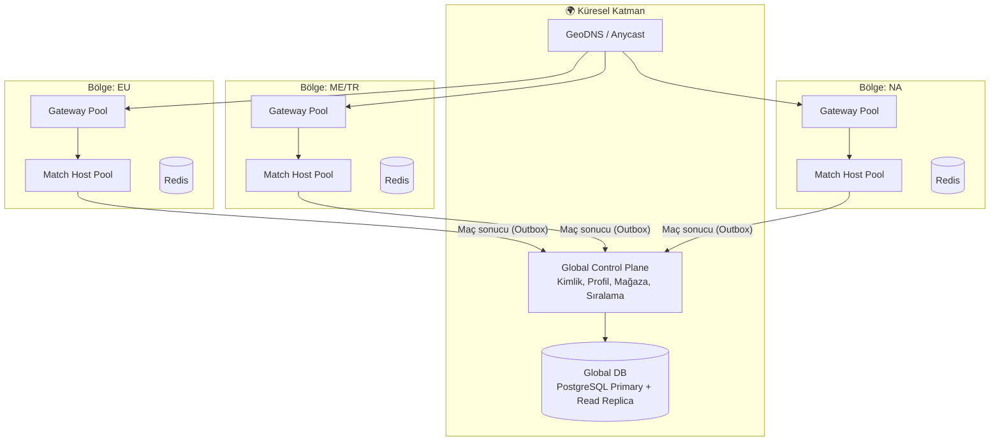

# 🚒 FIREMAN • Faz 3: Lansman, Ölçekleme, Canlı Operasyon ve Büyüme

> **Kapsam:** `Fireman_Faz2_Teknik_Yol_Haritasi.md` belgesinin devamıdır. Faz 2 sonunda; otoriter sunucu simülasyonu, netcode, matchmaking, anti-cheat v2, modern Flutter istemcisi ve kapalı beta tamamlanmış kabul edilir.
>
> **Faz 3 hedefi:** Oyunu **kapalı beta'dan genel yayına (GA)** taşımak, **küresel ölçekte güvenilir** işletmek, **rekabetçi ve sosyal bir ekosistem** kurmak ve **sürdürülebilir bir canlı operasyon (LiveOps) ve gelir modeli** oturtmak.
>
> **Doküman durumu:** Taslak v1.0 • **Ön koşul:** Faz 2 çıkış kriterleri (Bölüm 1) sağlanmış olmalı.

---

## 0. Faz 3 Vizyonu

| Boyut | Faz 2 Sonu | Faz 3 Sonu (Hedef) |
|-------|-----------|--------------------|
| Erişim | Kapalı beta, tek bölge | Genel yayın, **çok bölgeli** (EU, ME/TR, NA, Asya) |
| Ölçek | ~1.000 eşzamanlı oyuncu | **50.000+ eşzamanlı oyuncu**, 12.500+ eşzamanlı maç |
| Rekabet | Temel MMR | Dereceli lig, sezonluk sıralama, turnuva, izleyici modu |
| Sosyal | Arkadaş + davet | Klan, sohbet, parti sistemi, topluluk etkinlikleri |
| Operasyon | Manuel müdahale | Otomatik ölçekleme, runbook'lar, nöbet (on-call) düzeni |
| Gelir | Temel mağaza | Dengeli ekonomi, Battle Pass, A/B test edilmiş teklifler |
| Veri | Temel analytics | Deney platformu, churn tahmini, ekonomi panoları |

---

## 1. Faz 2 Çıkış Kriterleri (Faz 3'e Giriş Şartı)

Faz 3 işleri başlamadan önce aşağıdakiler doğrulanmalıdır. Biri eksikse önce o kapatılır.

- [ ] `GameCore` determinizm testleri %100 yeşil; replay ile bit-bit yeniden üretim doğrulandı.
- [ ] 250 eşzamanlı maçta tick p99 < 15 ms (yük testi raporu mevcut).
- [ ] Kapalı beta: crash-free kullanıcı oranı ≥ %99.5, maç kesinti oranı < %1.
- [ ] D1 tutundurma ≥ %35 (beta kohortunda).
- [ ] Pentest raporundaki **kritik/yüksek** bulguların tamamı kapatıldı.
- [ ] KVKK/GDPR veri envanteri ve silme/dışa aktarma akışları çalışıyor.
- [ ] CI/CD, IaC ve gözlemlenebilirlik hatları üretimde aktif.

---

## 2. İş Paketleri (Work Packages)

### WP14 — Çok Bölgeli (Multi-Region) Mimari ve Ölçekleme 🔴 P0

**Amaç:** Oyuncuyu en yakın bölgedeki oyun sunucusuna bağlayıp gecikmeyi düşürmek; tek bölge arızasında hizmeti sürdürmek.

**Hedef topoloji**

**Yapılacaklar**

- [ ] **Control Plane / Data Plane ayrımı:** Kimlik, profil, envanter, mağaza, liderlik **global**; gerçek zamanlı maç barındırma **bölgesel**.
- [ ] **Bölge seçimi:** İstemci ping ölçümü (bölge başına RTT probe) → matchmaking'e bölge tercihi bildirir.
- [ ] **Bölgeler arası matchmaking:** Kuyruk uzarsa komşu bölgelerle birleştirme (RTT üst sınırı ile).
- [ ] **Match Host orkestrasyonu:** Kubernetes üzerinde **HPA + KEDA** (aktif maç sayısı / kuyruk uzunluğuna göre ölçek); düğüm başına maç yoğunluğu sınırı.
- [ ] **Graceful drain:** Dağıtım sırasında yeni maç kabul etme, süren maçların bitmesini bekleme (maks. süre sonrası güvenli taşıma/sonlandırma).
- [ ] **Maç durumu dayanıklılığı:** Düğüm çökerse maçı kurtarma politikası (periyodik checkpoint → yeniden başlatma yerine devam; veya adil iptal + ödül iadesi).
- [ ] **Veri yerleşimi:** Yazma yükü için global primary + bölgesel okuma kopyaları; kritik cüzdan işlemleri tek yazma noktasında.
- [ ] **Yük dengeleme:** WebSocket/SignalR için sticky + **Redis backplane** ya da bölge içi tek-sahip (owner) modeli.
- [ ] **Kapasite planı:** Oyuncu başına CPU/bellek/bant genişliği maliyet modeli; tick bütçesine göre düğüm başına maç kapasitesi.
- [ ] **Yük/Dayanıklılık testi:** 50.000 eşzamanlı bağlantı, 12.500 maç simülasyonu; ani sıçrama (spike) ve bölge arızası senaryoları.

**Kabul kriterleri**

- Hedef bölgede p95 RTT < 80 ms (kullanıcıların ≥ %85'i için).
- Bir bölgenin tamamen kaybında, oyuncular **< 60 sn** içinde komşu bölgede yeni maç bulabilir.
- Dağıtım sırasında oyuncu kaynaklı maç kesintisi **sıfır**.

---

### WP15 — Güvenilirlik Mühendisliği (SRE) ve Operasyon 🔴 P0

**Yapılacaklar**

- [ ] **SLO / Hata bütçesi** politikası:
  | SLI | SLO |
  |-----|-----|
  | API erişilebilirliği | %99.9 / ay |
  | Maç bulma başarısı (60 sn içinde) | %98 |
  | Tick p99 | < 10 ms |
  | Maç kesinti oranı | < %0.5 |
  | Giriş (login) p95 | < 400 ms |
- [ ] Hata bütçesi tükenirse **özellik dondurma**, güvenilirlik odaklı sprint kuralı.
- [ ] **Nöbet (on-call) düzeni:** rotasyon, eskalasyon matrisi, PagerDuty/Opsgenie entegrasyonu.
- [ ] **Runbook'lar:** DB failover, Redis kaybı, tick aşımı, anti-cheat yanlış-pozitif dalgası, mağaza/IAP kesintisi, DDoS.
- [ ] **Olay yönetimi:** Severity seviyeleri (SEV1–4), olay komutanı rolü, **blameless postmortem** şablonu.
- [ ] **Chaos mühendisliği:** Düğüm öldürme, ağ gecikmesi/kaybı enjeksiyonu, Redis/DB yavaşlatma (staging'de sürekli, prod'da kontrollü "game day").
- [ ] **Felaket kurtarma (DR):** RPO ≤ 5 dk, RTO ≤ 30 dk hedefi; çeyreklik geri yükleme tatbikatı.
- [ ] **DDoS ve kötüye kullanım:** Edge'de WAF + hız sınırı, bağlantı başına bant sınırı, SYN/UDP flood koruması, IP itibar listeleri.
- [ ] **Bakım/Duyuru akışı:** Planlı bakım penceresi, oyun içi banner, durum sayfası (status page).
- [ ] **Maliyet gözlemi (FinOps):** Etiketleme, oyuncu başına maliyet (CCU/ARPDAU ile karşılaştırma), boşta kaynak raporu, spot/preemptible düğüm stratejisi.

---

### WP16 — Rekabetçi Sistemler ve E-Spor Altyapısı 🟠 P1

**Yapılacaklar**

- [ ] **Dereceli lig sistemi:** Bronz → Gümüş → Altın → Platin → Elmas → Usta; **Glicko-2 / TrueSkill 2** tabanlı MMR (belirsizlik/RD takibi), sezon başı yumuşak sıfırlama.
- [ ] **Yerleştirme maçları (placement):** İlk 5–10 maç ile başlangıç MMR tahmini.
- [ ] **Terk / smurf koruması:** Yeni hesap hızlı yükselme tespiti, cihaz/telefon doğrulama (opsiyonel), terk cezaları ve sıralı yasaklar.
- [ ] **İzleyici (Spectator) modu:** Sunucudan gecikmeli (örn. 30 sn) snapshot akışı; salt-okunur istemci; izleyici sayısı sınırı.
- [ ] **Replay sistemi (oyuncuya açık):** Girdi günlüğünden yeniden oynatma, yavaş çekim, serbest kamera, paylaşılabilir "replay kodu".
- [ ] **Turnuva motoru:** Eleme (single/double elimination), İsviçre sistemi, grup + play-off; otomatik bracket, hazır olma/WO kuralları, ödül dağıtımı.
- [ ] **Özel oda & turnuva yönetici araçları:** Maç gözlemleme, itiraz, sonuç onayı.
- [ ] **Liderlik tabloları:** Küresel, bölgesel, arkadaşlar, klan; sezonluk ve tüm zamanlar; sayfalama ve Redis sorted set.
- [ ] **Sezon kapanış akışı:** Ödül hesaplama (idempotent iş), arşivleme, sıralama dondurma, oyuncuya sezon özeti.
- [ ] **Anti-boosting / win-trading** tespiti (Faz 2 davranışsal analiz motoru ile entegre).

**Kabul kriterleri**

- MMR doğruluğu: simülasyonda (10.000 sentetik oyuncu) sıralama tahmini doğruluğu ≥ %65 (çift yönlü).
- Turnuva bracket üretimi ve ilerlemesi için tam otomasyon testi (8/16/32 katılımcı).

---

### WP17 — Sosyal Ekosistem ve Topluluk 🟠 P1

**Yapılacaklar**

- [ ] **Klan (Takım) sistemi:** Oluşturma, rol hiyerarşisi (lider/yönetici/üye), davet/başvuru, klan seviyesi, klan görevleri, klan sıralaması.
- [ ] **Parti sistemi:** 2–4 kişilik parti, ortak kuyruğa girme, parti lideri.
- [ ] **Sohbet:**
  - Lobi, parti, klan, özel mesaj kanalları (SignalR grupları).
  - **Hızlı ifade (emote/quick chat)** öncelikli; serbest metin için **moderasyon hattı** (yasaklı kelime, link filtresi, flood kontrolü, otomatik sessize alma).
  - Gençler için varsayılan kısıtlı mod.
- [ ] **Sosyal graf:** Çevrimiçi durum (presence), son oynananlar, engelleme listesi, "tekrar oyna" önerisi.
- [ ] **Şikayet/Moderasyon aracı:** `PlayerReport` → moderatör kuyruğu, kanıt (replay + sohbet kaydı) ekleme, otomatik ön-sınıflandırma, ceza şablonları, itiraz akışı.
- [ ] **Davet ve paylaşım:** Derin bağlantı (deep link), davet kodu, sosyal medya paylaşım kartları (maç sonu görseli), referral ödül sistemi (kötüye kullanım korumalı).
- [ ] **Topluluk kanalları:** Resmi Discord entegrasyonu (duyuru botu), oyun içi haber akışı (CMS tabanlı).
- [ ] **İçerik üretici desteği:** Replay paylaşımı, "yayıncı modu" (isim gizleme, bildirimleri kapatma).

---

### WP18 — Canlı Operasyon (LiveOps) Platformu 🟠 P1

**Amaç:** Mağaza güncellemesi beklemeden içerik, denge ve etkinlikleri yönetebilmek.

**Yapılacaklar**

- [ ] **LiveOps konsolu (web):**
  - Oyuncu arama ve profil inceleme (denetim izli).
  - Ceza/ban/uyarı, ekonomi düzeltme (denetim ve çift onay).
  - Duyuru/banner/mesaj kutusu yönetimi (zamanlanmış, segmentli).
  - Etkinlik oluşturucu (zaman penceresi, kurallar, ödüller, hedef segment).
- [ ] **Uzaktan yapılandırma (Remote Config):** Denge tablosu (`balance.json`), ödül oranları, harita rotasyonu, matchmaking parametreleri — **sürümlü, aşamalı yayın (staged rollout), anında geri alma**.
- [ ] **Feature Flag olgunlaştırma:** Segment/yüzde/bölge hedefleme, kill switch, bayrak ömrü yönetimi (eski bayrak temizliği).
- [ ] **İçerik pipeline'ı:** Sprite/ses/harita verisini **mağaza güncellemesi olmadan** indirme (CDN + içerik manifestosu, hash doğrulamalı, delta güncelleme).
- [ ] **Etkinlik tipleri:** Hafta sonu çift XP, tematik harita rotasyonu, sınırlı süreli mod (Takım 2v2, "Sadece varil", Hızlı bomba), mevsimsel kozmetikler.
- [ ] **Görev sistemi v2:** Günlük/haftalık/sezonluk görevler; sunucu tarafı olay akışı ile ilerleme; çeşitlilik ve yenileme (reroll) kuralları.
- [ ] **Bildirim stratejisi:** Segment bazlı push (kullanıcı yorgunluğunu önleyen sıklık sınırı, sessiz saatler, bölge saat dilimi).
- [ ] **Zorunlu güncelleme / sürüm uyumluluk matrisi:** İstemci–sunucu protokol sürümü; uyumsuz sürüme nazik yönlendirme.

---

### WP19 — Ekonomi, Monetizasyon ve Denge 🟠 P1

**Yapılacaklar**

- [ ] **Ekonomi tasarım dokümanı:** Para birimleri (Altın = yumuşak, Elmas = sert), **kaynak (faucet) ve gider (sink)** haritası, enflasyon kontrol mekanizmaları.
- [ ] **Simülasyon:** Oyuncu davranış profilleriyle ekonomi simülasyonu (Monte Carlo) — 30/90 günlük birikim ve harcama tahmini.
- [ ] **Mağaza kataloğu:** Kozmetikler (kask, ceket, patlama efekti, iz, emote, profil çerçevesi); **oynanışa etki eden satın alma yok** (pay-to-win yok).
- [ ] **Battle Pass v2:** Ücretsiz + Premium + "kademe atlama"; sezon teması, kozmetik ağırlıklı ödüller.
- [ ] **Sunucu tarafı IAP doğrulama:** Google Play Billing & StoreKit 2; **çift harcama, iade (refund), ters ibraz (chargeback)** akışları; satın alma defteri (ledger) ile mutabakat.
- [ ] **Fiyatlandırma & bölgesel fiyat:** Yerel para birimi katmanları, satın alma gücü paritesi, vergi/KDV uyumu.
- [ ] **Reklam (opsiyonel, ödüllü):** Rewarded video ile küçük ödül; sıklık sınırı; çocuk politikasına uyum; reklam yokluğu "Premium" avantajı olarak değerlendirilebilir.
- [ ] **Hile/dolandırıcılık:** Sahte makbuz tespiti, anormal harcama kalıpları, hesap ele geçirme sinyalleri.
- [ ] **Ekonomi panoları:** Günlük faucet/sink dengesi, ARPDAU, ARPPU, dönüşüm oranı, katman bazlı gelir, enflasyon göstergesi.
- [ ] **Şeffaflık:** Kutu (loot box) kullanılacaksa **olasılık açıklaması** ve bölgesel yasal uyum; tercihen doğrudan satın alma (bilinen içerik).

**Kabul kriterleri**

- IAP mutabakatı: günlük defter ile mağaza raporu arasında fark < %0.1.
- Ekonomi simülasyonu: 90 günde faucet/sink oranı hedef bantta (örn. 1.05–1.20).

---

### WP20 — Veri, Deney ve Oyuncu Zekâsı 🟠 P1

**Yapılacaklar**

- [ ] **Olay şeması yönetimi (Event Schema Registry):** Sürümlü, doğrulanan analytics olayları; PII içermeyen tasarım.
- [ ] **Veri hattı:** İstemci/sunucu olayları → kuyruk (Kafka/Event Hubs/PubSub) → ambar (BigQuery/ClickHouse/Snowflake) → modelleme (dbt) → panolar.
- [ ] **A/B deney platformu:**
  - Deterministik atama (kullanıcı kimliği + deney tuzu), istatistiksel güç hesabı, korumalı metrikler (guardrail).
  - Deney örnekleri: onboarding akışı, ilk maç eşleşme (bot oranı), mağaza düzeni, görev ödül miktarı.
- [ ] **Temel panolar:**
  - Edinim: kurulum, CPI, huni (ilk açılış → ilk maç → ilk galibiyet → D1).
  - Etkileşim: DAU/MAU, oturum süresi/sıklığı, maç/gün.
  - Tutundurma: D1/D7/D30 kohortları, sezon bazlı geri dönüş.
  - Maç sağlığı: eşleşme süresi, bot oranı, ortalama maç süresi, erken terk.
- [ ] **Tahminsel modeller:** Churn riski, LTV tahmini, matchmaking kalite skoru (beklenen adil maç olasılığı).
- [ ] **Oyuncu segmentasyonu:** Yeni, kararsız, sadık, yüksek harcama, rekabetçi; LiveOps hedeflemesinde kullanılır.
- [ ] **Geri bildirim döngüsü:** Oyun içi anket/NPS, mağaza yorumu analizi, destek talepleri etiketleme.
- [ ] **Gizlilik:** Rıza yönetimi (CMP), IDFA/ATT uyumu, veri minimizasyonu, saklama süresi politikası.

---

### WP21 — Gelişmiş Anti-Cheat ve Güven & Güvenlik (Trust & Safety) 🔴 P0

**Yapılacaklar**

- [ ] **Makine öğrenmesi destekli tespit:** Girdi zaman serisi özellikleri (tepki süresi dağılımı, girdi entropisi, rota düzgünlüğü) üzerinde anomali modeli; **insan incelemesi döngüsü** ile etiketleme.
- [ ] **Bot/otomasyon tespiti:** Makro/otoklikçi, emülatör + script, ekran okuyan botlar (istemci imza sinyalleri + sunucu davranış).
- [ ] **Hesap güvenliği:** Cihaz bağlama, şüpheli giriş uyarısı, MFA (opsiyonel), hesap kurtarma akışı, credential stuffing koruması (hız sınırı + sızıntı şifre kontrolü).
- [ ] **Ele geçirilmiş hesap / hesap satışı** tespit sinyalleri (ani cihaz/bölge değişimi + davranış sapması).
- [ ] **Ceza adaleti:** Kademeli yaptırım (uyarı → geçici → kalıcı), cihaz bazlı ban, itiraz süreci, şeffaf gerekçe mesajı.
- [ ] **Yanlış pozitif yönetimi:** Otomatik banlar için güven eşiği yüksek; düşük güvenli sinyaller "gölge havuz" (aynı hileli oyuncularla eşleştirme) uygulaması.
- [ ] **Hile topluluğu izleme:** Hile yazılımı dağıtım tespiti, imza güncellemeleri, hukuki/DMCA süreci.
- [ ] **Sertleştirme:** Protokol imza/nonce, paket yeniden oynatma koruması, istemci bütünlük attestation yenileme.
- [ ] **Şeffaflık raporu:** Aylık yaptırım istatistikleri (topluluk güveni için).

---

### WP22 — Platform Genişlemesi ve İstemci Olgunlaşması 🟡 P2

**Yapılacaklar**

- [ ] **iOS/Android eşitliği:** Cihaz matrisi testi (düşük/orta/yüksek segment, ≥ 40 cihaz), sürüm başına regresyon kontrolü.
- [ ] **Tablet / katlanabilir / büyük ekran** düzenleri; harici gamepad ve klavye desteği.
- [ ] **Performans modları:** Pil tasarrufu (30 FPS), standart (60 FPS), yüksek (90/120 Hz); termal kısma (thermal throttling) algılama.
- [ ] **Ağ dayanıklılığı:** Wi-Fi ↔ hücresel geçiş (connection migration), ağ kalitesi göstergesi, otomatik yeniden bağlanma geliştirmeleri.
- [ ] **Uygulama boyutu:** Asset sıkıştırma, isteğe bağlı içerik indirme, hedef: ilk kurulum < 50 MB.
- [ ] **Erişilebilirlik:** Renk körlüğü modları (patlama/tehlike işaretleri şekil + renk), ekran okuyucu uyumlu menüler, titreşim/ses alternatifleri, hareket azaltma.
- [ ] **Yerelleştirme genişlemesi:** TR, EN + ES, PT-BR, DE, FR, RU, AR (RTL), ID, JA/KO planı; kültürel/ifade denetimi.
- [ ] **Web/Masaüstü (araştırma):** Flutter Web / masaüstü derlemesi veya yalnızca izleyici/turnuva portalı olarak web istemcisi.
- [ ] **Widget / Canlı etkinlik:** Sezon ilerleme widget'ı, "maç hazır" bildirimi.

---

### WP23 — Kullanıcı Üretimi İçerik (UGC) ve Genişleme Modları 🟡 P2

**Yapılacaklar**

- [ ] **Harita editörü:** Izgara tabanlı, doğrulama kuralları (dört köşe güvenli, erişilebilirlik/BFS bağlantı kontrolü, dengeli güç-yükseltici yerleşimi).
- [ ] **Harita paylaşımı:** Yayınlama, oy/favori, haftanın haritası, **moderasyon + otomatik doğrulama** (kopya/uygunsuz içerik).
- [ ] **Yeni oyun modları:**
  - **Takım Savaşı (2v2)** — dost ateşi kuralları.
  - **Kral Tepesi (King of the Hill)** — merkez bölge puanı.
  - **Battle Royale (16 oyuncu)** — daralan arena.
  - **Hayatta Kalma (PvE dalga)** — arkadaşlarla co-op.
  - **Hızlı Mod** — kısa fitil, hızlı hareket.
- [ ] **Mod altyapısı:** `GameCore` kural seti **veri güdümlü** (kural paketleri); yeni mod = yeni kural paketi + istemci UI.
- [ ] **Kozmetik yaratıcı programı:** Topluluk tasarımlı kozmetik, gelir paylaşımı (uzun vadeli).
- [ ] **Başarım (achievement) sistemi:** Google Play Games / Game Center entegrasyonu.

---

### WP24 — Hukuk, Uyumluluk ve Mağaza Operasyonu 🟠 P1

**Yapılacaklar**

- [ ] **Gizlilik:** KVKK, GDPR, CCPA/CPRA; çocukların verisi (COPPA) — yaş kapısı ve ebeveyn rızası akışı.
- [ ] **Mağaza politikaları:** Google Play / App Store inceleme gereklilikleri, veri güvenliği formu, yaş derecelendirmesi (IARC / PEGI / ESRB), IAP ve abonelik kuralları.
- [ ] **Kullanım Şartları / Gizlilik Politikası / EULA** sürümleme ve yeniden onay akışı.
- [ ] **Kutu (loot box) ve rastgele ödül** düzenlemeleri (ülkeye göre) için bölgesel kapatma anahtarı.
- [ ] **Vergi & muhasebe:** Bölgesel KDV/VAT, mağaza komisyonu, gelir tanıma süreci.
- [ ] **Fikri mülkiyet:** Marka tescili ("Fireman"), varlık (asset) lisansları envanteri, üçüncü taraf bileşen lisans uyumu (SBOM).
- [ ] **Hesap silme ve veri dışa aktarma:** 30 gün içinde tamamlanma SLA'sı, uçtan uca test.
- [ ] **Destek operasyonu:** Yardım merkezi, uygulama içi destek formu (log/cihaz bilgisi ile), SLA, makrolar, geri ödeme politikası.

---

### WP25 — Lansman Operasyonu ve Pazarlama Teknolojisi 🟠 P1

**Yapılacaklar**

**Lansman aşamaları**

| Aşama | Kapsam | Kapı (Gate) Kriteri |
|-------|--------|---------------------|
| **Soft Launch** | 1–2 küçük pazar (örn. TR + 1 ülke), organik + sınırlı UA | D1 ≥ %38, D7 ≥ %16, crash-free ≥ %99.5, ekonomi stabil |
| **Kademeli Genişleme** | Bölge bölge açılış, günlük kapasite artışı | SLO'lar korunuyor, destek kuyruğu yönetilebilir |
| **Global Lansman (GA)** | Tüm hedef pazarlar | Yük testi + DR tatbikatı onaylı, nöbet düzeni hazır |
| **Lansman sonrası (Hypercare)** | İlk 4 hafta 7/24 yakın izleme | Günlük sağlık toplantısı, hızlı yama yayını (hotfix) |

- [ ] **Ön kayıt (pre-registration)** kampanyası ve ödülü.
- [ ] **Edinim (UA) altyapısı:** Attribution (AppsFlyer/Adjust), SKAdNetwork/AdAttributionKit, deep link ile kampanya takibi.
- [ ] **Mağaza sayfası optimizasyonu (ASO):** Ekran görüntüsü/video A/B testi (mağaza deneyleri), anahtar kelime, yerelleştirilmiş sayfa.
- [ ] **Basın/İçerik üretici kiti:** Medya kiti, fragman, GIF/klip, erken erişim anahtarları.
- [ ] **Lansman etkinliği:** Açılış sezonu, açılış turnuvası, lansman ödül paketi.
- [ ] **Hotfix süreci:** Feature flag + remote config ile istemci güncellemesiz düzeltme; hızlı yama için "fast-track" CI hattı.
- [ ] **Geri alma planı:** Sunucu sürüm geri alma, protokol uyumluluğu, veri geri dönüşü.

---

## 3. Sprint Planı (Faz 3 • 2 haftalık sprintler)

| Sprint | Odak | Çıktı |
|--------|------|-------|
| **S11** | WP15 SLO/runbook/on-call, WP14 kapasite modeli, WP24 uyumluluk denetimi | SLO panoları, ilk runbook seti, uyumluluk boşluk raporu |
| **S12** | WP14 çok bölge altyapısı (IaC), global/bölgesel ayrım | 2 bölgede çalışan Match Host havuzu |
| **S13** | WP14 ölçek + yük testi, WP15 chaos & DR tatbikatı | 50k CCU yük testi, DR raporu |
| **S14** | WP19 ekonomi simülasyonu + IAP sunucu doğrulama, WP20 olay şeması & veri hattı | Ekonomi dokümanı, IAP mutabakatı, analytics ambarı |
| **S15** | WP18 LiveOps konsolu + Remote Config + içerik CDN pipeline | Yayın içi içerik/denge yönetimi |
| **S16** | WP16 dereceli lig, izleyici, replay (oyuncuya açık) | Lig sistemi + izleyici modu |
| **S17** | WP17 klan/parti/sohbet + moderasyon aracı | Sosyal özellik paketi |
| **S18** | WP21 ML anti-cheat + hesap güvenliği, WP20 A/B platformu | Tespit modeli v1, deney platformu |
| **S19** | **Soft Launch** (WP25) + hypercare, WP22 cihaz matrisi/erişilebilirlik | Soft launch metrikleri, hata düzeltmeleri |
| **S20** | Kademeli genişleme → **GA kararı**, WP16 turnuva motoru | GA yayını, ilk turnuva |
| **S21+** | WP23 harita editörü, yeni modlar, platform genişlemesi (sürekli) | Sezon 2 içeriği ve UGC |

---

## 4. Genel Kabul Çerçevesi (Faz 3 Definition of Done)

- [ ] Her özellik **feature flag + uzaktan yapılandırma** ile açılıp kapatılabilir.
- [ ] Yeni özelliklerin **SLO etkisi** ve **kapasite etkisi** değerlendirildi.
- [ ] **Deney planı** (varsa) ve başarı metrikleri tanımlı; guardrail metrikleri izleniyor.
- [ ] **Runbook** ve uyarı kuralları güncel; nöbet ekibi bilgilendirildi.
- [ ] Gizlilik/uyumluluk gözden geçirmesi tamam (yeni veri toplama varsa DPIA).
- [ ] Yerelleştirme ve erişilebilirlik kontrol listesi geçildi.
- [ ] Geri alma (rollback) yolu test edildi.

---

## 5. KPI ve Başarı Ölçütleri (Genel Yayın Sonrası)

| Alan | Metrik | 30. Gün Hedefi | 90. Gün Hedefi |
|------|--------|----------------|----------------|
| Büyüme | Toplam kurulum | 250.000 | 1.000.000 |
| Etkileşim | DAU | 40.000 | 150.000 |
| Etkileşim | DAU/MAU (yapışkanlık) | ≥ %20 | ≥ %25 |
| Tutundurma | D1 / D7 / D30 | %40 / %18 / %8 | %42 / %20 / %10 |
| Oturum | Ortalama oturum süresi | 14 dk | 16 dk |
| Oturum | Günlük maç sayısı (oyuncu başı) | 4.5 | 5.5 |
| Gelir | Ödeme yapan oranı | %1.5 | %2.5 |
| Gelir | ARPDAU | $0.05 | $0.08 |
| Teknik | Crash-free kullanıcı | ≥ %99.6 | ≥ %99.8 |
| Teknik | Maç bulma süresi (medyan) | < 12 sn | < 8 sn |
| Güven | Doğrulanmış hile oranı | < %0.5 | < %0.3 |
| Topluluk | Mağaza puanı | ≥ 4.3 | ≥ 4.5 |
| Destek | İlk yanıt süresi | < 24 sa | < 12 sa |

> *Hedefler benchmark varsayımlarıdır; soft launch verisiyle kalibre edilmelidir.*

---

## 6. Riskler ve Önlemler

| Risk | Olasılık | Etki | Önlem |
|------|----------|------|-------|
| Lansman sonrası ani trafik patlaması (viral) | Orta | Yüksek | Otomatik ölçekleme, kuyruk (waiting room), kademeli açılış, kapasite rezervi |
| Bölgesel bulut arızası | Düşük | Yüksek | Çok bölge, DR tatbikatı, komşu bölgeye taşma |
| Ekonomi enflasyonu / dengesizlik | Orta | Yüksek | Simülasyon, panolar, uzaktan yapılandırma ile hızlı düzeltme |
| Pay-to-win algısı / topluluk tepkisi | Orta | Yüksek | Yalnızca kozmetik satış ilkesi, şeffaf iletişim |
| Hile dalgası / bot ordusu | Yüksek | Yüksek | ML tespit, gölge havuz, cihaz doğrulama, hızlı yaptırım |
| Düşük tutundurma (D7/D30) | Orta | Yüksek | Deney platformu, görev/ilerleme döngüsü iyileştirmesi, sosyal özellikler |
| Zehirli (toxic) topluluk | Orta | Orta | Hızlı ifade odaklı sohbet, moderasyon hattı, engelleme, ceza adaleti |
| Mağaza reddi / politika ihlali | Düşük | Yüksek | Erken uyumluluk incelemesi, politika takibi, alternatif dağıtım planı |
| Maliyet aşımı (altyapı) | Orta | Orta | FinOps, spot düğümler, oyuncu başına maliyet takibi, kapasite optimizasyonu |
| Ekip tükenmişliği (lansman baskısı) | Orta | Orta | Nöbet rotasyonu, hypercare sonrası telafi, gerçekçi kapsam |

---

## 7. İlk 12 Görev (Faz 3 Başlangıcı)

1. [ ] Faz 2 çıkış kriterleri denetimini yap ve eksikleri kayda geçir.
2. [ ] SLO/SLI tanımlarını resmileştir; hata bütçesi politikasını onaya sun.
3. [ ] Bölgesel yerleşim için **ADR-0010: Control Plane / Data Plane ayrımı** yaz.
4. [ ] Kapasite modeli: düğüm başına maç yoğunluğu ölçümü (tick bütçesi benchmark'ı).
5. [ ] Terraform ile ikinci bölge (staging) altyapısını kur; Redis/Gateway/Match Host havuzlarını dağıt.
6. [ ] İlk runbook seti (DB failover, Redis kaybı, tick aşımı, DDoS) + on-call rotasyonu.
7. [ ] Ekonomi tasarım dokümanını (faucet/sink haritası) yaz ve simülasyon prototipini çalıştır.
8. [ ] Sunucu tarafı IAP doğrulama + satın alma defteri mutabakat işini başlat.
9. [ ] Analytics **olay şeması** (v1) ve veri hattı iskeleti; PII denetimi.
10. [ ] Remote Config servisi + sürümlü `balance.json` dağıtımı (staged rollout, geri alma).
11. [ ] Mağaza uyumluluk denetimi (gizlilik formu, yaş derecelendirmesi, IAP politikaları) ve eksik listesi.
12. [ ] Soft launch pazar seçimi ve kapı (gate) metriklerinin onayı.

---

## 8. Hedef Teknoloji Yığını (Faz 3)

| Katman | Faz 2 | Faz 3 Eki |
|--------|-------|-----------|
| Orkestrasyon | Docker, K8s (tek bölge) | **Çok bölgeli K8s**, HPA + KEDA, Karpenter/Cluster Autoscaler |
| Edge / Ağ | LB + TLS | **GeoDNS/Anycast**, WAF, DDoS koruması, CDN |
| Veri | PostgreSQL + Redis | + okuma kopyaları, **Kafka/PubSub**, veri ambarı (ClickHouse/BigQuery), dbt |
| Gözlemlenebilirlik | OTel, Prometheus, Grafana | + SLO araçları (Sloth/Pyrra), PagerDuty, status page |
| Deney / Config | Feature flags | **A/B platformu**, Remote Config, içerik CDN manifesti |
| ML | — | Anomali tespiti (Python/ONNX), churn/LTV modelleri (batch) |
| Mobil | Flutter + Flame + Riverpod | + Attribution SDK, Play Games / Game Center, CMP |
| IaC / Güvenlik | Terraform, CodeQL | + Policy-as-code (OPA), gizli rotasyon, SBOM imzalama |

---

## 9. Faz 4 İçin Ön Notlar (Gelecek Vizyonu)

- Çapraz platform (PC/Web) ve **cross-play**.
- Topluluk turnuvaları için **kendi barındırılan sunucu** (self-host) seçeneği.
- Kozmetik pazaryeri (oyuncular arası takas, **sıkı dolandırıcılık kontrolleriyle**).
- Marka işbirlikleri ve sınırlı etkinlik sezonları.
- Yapay zekâ destekli **uyarlanabilir zorluk** botları ve kişiselleştirilmiş öğretici.

---

> **Not:** Faz 3, teknik olduğu kadar **operasyonel ve ürün odaklı** bir fazdır. Başarı yalnızca yeni özelliklerle değil; **güvenilirlik, topluluk sağlığı ve sürdürülebilir ekonomi** ile ölçülür. Her sprint sonunda KPI'lar ve riskler yeniden değerlendirilmeli, kararlar `docs/adr/` altında kayıt altına alınmalıdır.
