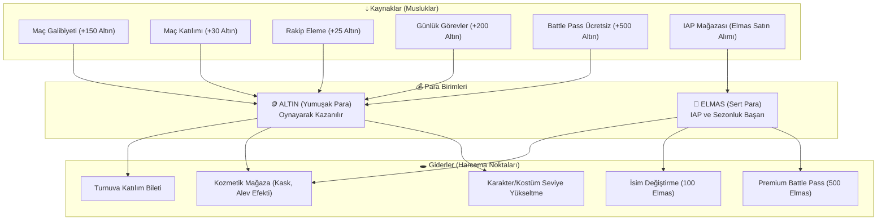

# Fireman Oyun Ekonomisi Tasarım Dokümanı (Faucet & Sink Modeli)

> **Amaç:** WP19 kapsamında enflasyonsuz, adil, dengeli ve pay-to-win içermeyen sürdürülebilir bir mobil ekonomi kurmak.

---

## 1. Para Birimleri Mimarisi

---

## 2. Denge Kuralları ve Değişmezler (Invariants)

1. **Pay-to-Win Yasağı:** Altın veya Elmas ile doğrudan oyun içi hız, menzil veya hasar artırıcı avantaj **satın alınamaz**. Güçlendiriciler sadece maç esnasında varil kırarak düşer.
2. **Faucet / Sink Oranı:** 30 günlük oyuncu simülasyonunda harcama / kazanma oranı **%85 - %95** bandında tutulur (hafif pozitif birikim, sıfır hiperenflasyon).
3. **Günlük Altın Üst Sınırı (Cap):** Bir günde maçlardan kazanılabilecek azami altın miktarı 1.500 ile sınırlandırılır (bot/otomasyon suistimaline karşı önlem).
